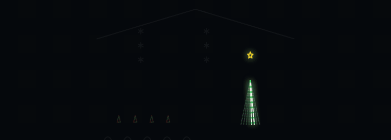

# LOR Sequencer

**Light-O-Rama sequences, without the hundred hours.**

Sequencing one song by hand can eat a whole weekend, and it helps to have an ear for music. LOR Sequencer does it for you: give it your Light-O-Rama display and a song, and you get back a native sequence that knows your arches from your snowflakes. It works with S4, S5 and S6.



*The invented demo yard, playing the show the program made for it.*

### [Download for Windows](https://github.com/MikeAllen1/light-o-rama-sequence-builder/releases/latest)

Free. No administrator rights needed, and everything it needs is included. Running a newer installer later replaces the old one, and the app tells you when there is one. Can't run installers on your PC? Take the **Portable** zip from the same page: unzip it and run `LOR Sequencer.exe`.

## How it works

1. **Your display.** Choose the S5/S6 `.lorprev` you already have, or with S4, any of your `.lms` sequences. It is the map: every prop, its channels, and where it stands in the yard.
2. **Your song.** Any MP3, WAV or M4A. The program finds the beats, the bars, the loud parts, the sleigh bells and the cymbal crashes.
3. **Your show.** Pick a style and click **Generate show**. Watch it play on a drawing of your yard, then save it (`.loredit` for S5/S6, `.lms` for S4) and open it in the Light-O-Rama Sequencer. Play it as it is, or fine-tune it there.

## What your show does

Every kind of prop gets one job for the whole song, so the yard looks planned rather than random:

- **Arches** chase on the beat.
- **Mini trees** trade beats back and forth.
- **Snowflakes** fall, on the sleigh bells when the song has them.
- **The mega tree** spins.
- **Singing faces** sing along (with the optional vocals add-on).
- **Outlines and stars** are the steady glow underneath.

Quiet parts of the song use a few props; loud parts use more. A chorus that comes back looks like it did the first time, the phrase before a big part builds up, and the crashes flash the whole yard.

You can also:

- **Pick a style:** Classic, High energy (busy and punchy) or Elegant (calm, for ballads).
- **Set requirements** like "keep the star on all song" or "keep the mega tree dark in the verses". They are remembered for your display.
- **Do a whole playlist at once:** choose several songs and save all the shows in one go.
- **Run a 10-second display test** that lights every prop in a fixed order, to check your wiring before the real show.
- **Read the show report:** what was used, what stayed dark and why, and what to check in the yard.

## Good to know

- **It runs on your computer.** Your preview and your music never leave it. The only thing it asks the internet is whether a newer version is out, and you can turn that off.
- **S4, S5 and S6 all work.** With S5 or S6, choose your `.lorprev`; you get a `.loredit`. With S4 (no previews), choose one of your own S4 sequences (`.lms`) as the display: each channel becomes a prop, and you get a new `.lms` with the same channels. See [docs/S4_FORMAT.md](docs/S4_FORMAT.md).
- **You need Light-O-Rama S4, S5 or S6** to play the shows. Standard LOR props (channel per color, multi-segment) are sequenced; pixel (RGB) and DMX props are listed in the report but not sequenced yet.
- **Better previews make better shows.** Giving props a real S6 shape (Arch, Tree, Snowflake) and grouping rows helps. The [user guide](docs/USER_GUIDE.md) has tips and fixes for common problems.
- **Free to use, not to sell.** See [License](#license).
- Not affiliated with or endorsed by Light-O-Rama, Inc. "Light-O-Rama" and "S6" are theirs.

## Other ways to run it

### Run it from the source folder instead

1. **Install uv** (it installs everything else). Open PowerShell and paste:
   ```powershell
   powershell -ExecutionPolicy ByPass -c "irm https://astral.sh/uv/install.ps1 | iex"
   ```
2. **Install FFmpeg** (it reads your songs):
   ```powershell
   winget install --id Gyan.FFmpeg -e
   ```
   The launcher offers to do this for you if it is missing.
3. **Get the program:** on GitHub, choose **Code → Download ZIP**, and unzip it anywhere (for example `Documents\LOR Sequencer`).
4. **Start it:** double-click **Start LOR Sequencer** in that folder. The first start takes a few minutes to set up; after that it opens in your browser in seconds. Keep the black window open while you use it.
5. **Build a show:** click **New show**, choose your display's S5/S6 preview (`.lorprev`) or, with S4, one of your sequences (`.lms`), choose the song, pick a style (Classic, High energy or Elegant), and click **Generate show**. Watch it in the **Yard view** with the song, open the **Show report**, then **Save show** and open the `.loredit` in the S6 Sequencer.

On macOS or Linux, install uv and FFmpeg the same way for your system and run `start-lor-sequencer.sh`.

**Not sure it is set up right?** In the program folder run `uv run lor-sequence-builder doctor`: it checks everything and says how to fix what is missing. `uv run lor-sequence-builder demo "Demo Show"` builds a complete show for an invented yard and song, without any of your files.

The [user guide](docs/USER_GUIDE.md) walks through a first show, requirements, singing faces and common problems.

## What you get for each show

- `<song> (generated).loredit` (S5/S6) or `.lms` (S4): the native sequence. Open it in the Sequencer to play it or fine-tune it.
- **Show report** (`.report.html`): what was used and left dark and why, props it cannot sequence (pixel, DMX), your requirements, every rule, the song's parts and big moments, and a checklist for the yard.
- **Plan picture** (`.plan.svg`): the whole show at a glance.
- **10-second display test**: before a full show, light every prop in a fixed order to check the wiring (`display-test`, or **Make 10-second test** in New show).
- Details for the curious: the plan, the timeline and the rule results as JSON.

## Command line

Everything in the browser also works from the command line:

```powershell
uv run lor-sequence-builder generate --preview display.lorprev --audio song.mp3 --output song.loredit
uv run lor-sequence-builder generate ... --style energetic   # classic (default), energetic or elegant
uv run lor-sequence-builder generate ... --lyrics song.lrc   # props the singer names light on the word
uv run lor-sequence-builder generate-batch --preview display.lorprev --songs Playlist --output Shows
uv run lor-sequence-builder generate ... --rules examples\requirements\gentle-show.yaml
uv run lor-sequence-builder requirements display.lorprev   # describe your display's requirements once
uv run lor-sequence-builder analyze-preview display.lorprev --report display.analysis.json
uv run lor-sequence-builder doctor
uv run lor-sequence-builder demo "Demo Show"
```

Example requirement profiles are in [examples/requirements](examples/requirements/README.md).

## For developers

```powershell
git clone https://github.com/MikeAllen1/light-o-rama-sequence-builder.git
cd light-o-rama-sequence-builder
uv sync --locked
uv run lor-sequence-builder --help
```

Python 3.12 or newer and `uv` are required; FFmpeg must be on PATH. The workflow is: `analyze-preview` reads the `.lorprev` and reports what each prop is, with evidence; correct anything wrong in the S6 Preview Editor itself (shape type, grouping, start location, name); `generate` creates the native `.loredit`, a Timeline JSON file and the reports. See [docs/PLAN.md](docs/PLAN.md) for the phase order and handoff log, and [docs/ARCHITECTURE.md](docs/ARCHITECTURE.md) for system boundaries and data contracts.

## Command reference

Inspect a sequence:

```powershell
uv run lor-sequence-builder inspect .\path\to\show.loredit
```

Inspect a standalone S6 display preview:

```powershell
uv run lor-sequence-builder inspect-preview .\path\to\display.lorprev
```

Write a new round-trip copy (the destination must not already exist):

```powershell
uv run lor-sequence-builder roundtrip .\path\to\show.loredit .\output\roundtrip.loredit
```

The LOREDIT reader currently accepts only `saveFileVersion="15"`, the version represented by the reviewed fixture. A preview's internal `Revision` value is an edit counter that S6 increments each time the preview is saved; the parser records it but never uses it to accept or reject a preview. XML is parsed with `defusedxml`, with DTDs, entities, and external references forbidden. The writer preserves the parsed XML tree opaquely and atomically creates a new output without overwriting the input or an existing destination.

The preview is the authoritative display map. For LOR props, each `ChannelGrid` row exposes network, Unit ID, and the circuit value present in that row; for DMX props, universe and channel are exposed. These are address fields only: remaining fields are retained verbatim and are not yet semantically interpreted. The original row and source locator are retained. The parser enforces a 20 MiB input limit, 256-level XML nesting limit, and 100,000-element limit, and reports missing or duplicate prop IDs rather than treating them as reliable identities. `PropGroup` and `member` records are parsed into typed group/member models, including prop ID references, arrangement, orientation, top, and left values. The repository's current fixture set is synthetic; larger preview examples are generated at test time.

## Identify props in a preview

```powershell
uv run lor-sequence-builder analyze-preview .\display.lorprev --report .\display.analysis.json
```

Reads the preview only (never modifies it) and lists each prop as confident, needs review, or unknown, with its role, row position, direction, color capability, and whether v1 can sequence its channels. Evidence comes from the S6 shape type and parameters, geometry, channel count and type, groups and their order, links to master props, and the string start location. When the S6 shape type is specific (Arch, Star, Tree...), it wins over the name; when a prop is drawn as plain lines, its name decides and the prop is flagged for review. To correct a conclusion, fix the prop in the S6 Preview Editor and run the command again.

## Browser sequencing workspace

Start the local browser-based sequencing interface:

```powershell
uv run lor-sequence-ui
```

The server binds only to `127.0.0.1`. Open an S5/S6 `.loredit` (v15) or S4 `.lms` (v14) and its matching audio. The workspace builds tracks from the sequence's actual props, channels, embedded prop groups, timing grids, and effects; the waveform is decoded from the selected audio. When served by this command, the selected audio is sent only to the local Python analysis endpoint and held in a temporary directory while the existing librosa analyzer runs. The source audio and sequence are not modified or retained by the server.

The workspace supports synchronized navigation, playback, musical marker visualization, track expansion/collapse, and effect editing: select, move, trim, create, delete, duplicate, undo/redo, snapping to musical events, one-click retiming of out-of-sync hits, and a checked export to a new file. A music review corrects beats, bars, crashes, hits, section names and lyrics, fits a tempo map between confirmed bars, and saves a review file that `generate --analysis` accepts (see docs/SEQUENCER_UI.md). Optional saved audio-analysis JSON and `vocals-1.0` JSON can be loaded. Vocal regions and syllable candidates are heuristic; the current vocal format does not recognize words or provide lyrics.

This is a browser application, not a desktop wrapper. Do not install Electron, Tauri, or another desktop framework during the sequencing-workspace phases.

## Build a show

```powershell
uv run lor-sequence-builder generate --preview .\display.lorprev --audio .\Song.mp3 --output .\Song.loredit
```

Before building, it asks whether you have any specific requirements (skipped when you have saved ones; `--ask-requirements` always asks, `--no-ask` never does). It then analyzes the song, splits it into sections by energy, plans each kind of prop (rows of arches and mini trees chase or fill in their real order, a mega tree rotates, outlines and decorations hold or pulse), checks the plan against every rule and requirement, and writes:

- `Song.loredit`: the sequence. Put the song in your S6 audio folder; `--music-filename` sets the stored name (default: the audio file's name).
- `Song.plan.svg`: a picture of the whole show, one lane per prop, that opens in any browser or on a phone.
- `Song.timeline.json`, `Song.plan.json`, `Song.rules.json`: every decision, the section plan with props used and left out, and the rule report.
- `Song.analysis.json` and `Song.analysis.svg`: the music analysis. Pass `--analysis` instead of `--audio` to reuse one.

### Lyrics for the workspace

The browser workspace can show timed lyrics under the waveform:

```powershell
uv run lor-sequence-builder lyrics --import .\Song.lrc --output .\Song.lyrics.json
uv sync --locked --extra lyrics   # optional, once: offline speech recognition
uv run lor-sequence-builder lyrics --audio .\Song.vocals.wav --output .\Song.lyrics.json
```

Imported LRC, SRT or VTT lyrics are your own text. Transcribed lyrics are always marked unverified, because speech recognition mishears sung words; a vocals-only track gives the best timing. Nothing is sent anywhere.

### Singing faces

Faces drawn as separate props (outline, mouth shapes, eyes) sing along: the mouth opens on each syllable (wider on stronger ones, an "O" mouth on some held notes when you have one, the closed mouth between words), the eyes blink every few seconds, the outline stays on whenever a mouth is on, and the face rests during instrumentals. Parts are recognized by their names in the preview: `outline`; `mouth` or `lips` with `closed`, `half`, `open`, or `o`; `eyes open`, `eyes closed`.

That needs the vocals on their own. Either:

- pass a vocals-only file you already have: `--vocals .\Song-vocals.wav`, or
- install the optional separation add-on once, and `generate` splits the vocals out of the song itself (only when your display has face mouths):

  ```powershell
  uv sync --locked --extra vocals
  ```

  It is a large install (PyTorch), downloads a 67 MB model the first time, and then runs offline. Splitting takes a few minutes per song (about 6 on a 2-core machine); the result is saved as `Song.vocals.wav` and `Song.vocals.json`, and either can be passed to `--vocals` next time. `--no-vocals` skips it.

Without vocals, face mouths stay still and the rest of the face lights with the show.

## Rules and display requirements

Every choreography Timeline is checked against built-in rules (no overlapping effects, movements that finish, falls that go down, a face outline whenever a mouth is on, and more) plus any requirements you add in your own rule profile. A Timeline with rule errors is never written to a sequence.

Before building, tell it what you want in your own words (or answer a few questions about your display). Confirmed requirements are saved next to the preview and used by every later build:

```powershell
uv run lor-sequence-builder requirements .\display.lorprev
uv run lor-sequence-builder list-rules --rules .\my-display.yaml
uv run lor-sequence-builder check-timeline .\display.lorprev .\plan.json --rules .\my-display.yaml
uv run lor-sequence-builder build-from-timeline --preview .\display.lorprev --timeline .\plan.json --music-filename "Song.mp3" --output .\song.loredit --report .\song.rules.json
```

See [docs/RULES.md](docs/RULES.md) for every rule, the profile format, and the Timeline format.

## Phase 4 audio analysis

Install FFmpeg and ensure `ffmpeg` is available on PATH. FFmpeg decodes any supported audio format to mono 22.05 kHz signed 16-bit PCM; librosa then analyzes the decoded samples (it never opens files itself). The command writes a versioned JSON report plus an SVG diagnostic plot:

```powershell
uv run lor-sequence-builder analyze-audio .\song.mp3 --output-json .\song.analysis.json --plot .\song.analysis.svg
```

The report contains tempo (with a stability confidence), beats from a dynamic-programming beat tracker, downbeats chosen from harmonic change, onsets, an energy curve, four-bar phrase candidates, unlabelled section candidates (self-similarity plus loudness change at bar starts, and broad energy transitions), and hard-stop candidates. Every inferred event records its method and a heuristic confidence. The formal contract is [audio-analysis-v2.schema.json](docs/schemas/audio-analysis-v2.schema.json). Output files must be new paths and are never overwritten.

Add `--beats-per-bar 3` for songs counted in 3; the default is 4.

Experimental, off by default: `--vocals .\song-vocals.wav` lets a vocals-only track re-place beats in stretches where the band's own tempo drifts (the band following the singer). It helped on generated rubato songs but not on the real songs it was checked against, where the plain beat tracker did as well or better, so `generate` only uses it with `--vocal-beats`. The report lists any re-placed stretches under `beat_guidance`.

Score the analysis against timing grids you placed by hand in an existing sequence for the same song:

```powershell
uv run lor-sequence-builder evaluate-analysis --analysis .\song.analysis.json --sequence .\song.loredit --beats-grid "Beats" --bars-grid "Bars" --sections-grid "Sections"
```

See the [audio analysis review procedure](docs/AUDIO_ANALYSIS_REVIEW.md) for acceptance targets and how to read the results.

## Pulse sequences (engineering harness)

The `pulse` command proves the preview → Timeline → native S6 writer path using a fixed BPM. It does not analyze audio or create intelligent choreography. It builds a brand-new native S6 v15 sequence from the preview alone; no template sequence is needed:

```powershell
uv run lor-sequence-builder pulse --preview .\display.lorprev --bpm 120 --duration-seconds 180 --music-filename "Show\song.mp3" --output .\pulse-test.loredit --timeline-output .\pulse-test.timeline.json
```

`--music-filename` is stored in the sequence the way S6 records it (S6 always attaches an audio file to a musical sequence). Props linked to a master prop are driven by their master and get no sequence prop of their own; props without a verified channel layout (pixel/RGB, DMX, legacy AC/DC, unassigned) are excluded and listed in the output. See the new-sequence structure in [docs/S6_FORMAT.md](docs/S6_FORMAT.md).

The older template mode (`--template`, a native S6 v15 sequence whose embedded preview matches the standalone preview exactly) still works but is deprecated. The rules below apply to it.

The verified Phase 3 boundary is `DeviceType=LOR` with `TraditionalType=Single Color`, `Multicolor_string_1_ch`, or `Channel_per_color`. The standalone preview and embedded template must have identical prop subtrees (all attributes and nested data, including geometry and master-prop references) and identical `PropGroup` membership/layout. Numeric geometry and group coordinates allow only a 1e-6 tolerance. Preview edit revisions are ignored, since they only count saves.

Physical mapping is deliberately strict. Each LOR `ChannelGrid` entry must have a complete network/Unit ID/circuit address, and the number of entries must equal the native `SeqProp/channel` count. Entry order is mapped to native channel coordinates using observed S6 v15 patterns: `Single Color` and `Multicolor_string_1_ch` use row 0 and sequential columns; `Channel_per_color` uses row 0, column 0, and sequential color coordinates. These addresses are included in each Timeline channel reference. A prop with no native `SeqProp`, incomplete address, count mismatch, or unverified native coordinates is explicitly listed as excluded with a reason; no mapping is invented. Legacy `DeviceType=AC` and `DC` values remain parseable for preview compatibility but are explicitly excluded from Phase 3 because their native mapping is not verified. Unsupported prop types are also listed in the Timeline.

Existing effects in the template copy are intentionally removed before the generated intensity pulses are inserted; the source template is never modified. The template's duration controls the generated sequence duration. This is a plumbing harness, not a professional choreography generator. The owner must still open and play the generated file in S6 and verify the intended physical lights respond correctly; automated mapping checks do not replace that gate.

The command writes a deterministic, versioned Timeline JSON and a new `.loredit`; it refuses to overwrite inputs or existing outputs. It bounds generation to 50,000 beats and 250,000 events. The generated file still requires manual opening and playback verification in the target S6 release.

## Development checks

The CI workflow pins the development tools and runs:

```powershell
uv run --no-sync --with pytest==9.2.0 --with ruff==0.17.4 --with mypy==1.18.2 --with pip-audit==2.10.1 --with types-defusedxml==0.7.0.20260504 --with types-PyYAML==6.0.12.20260906 python -m pytest
uv run --no-sync --with pytest==9.2.0 --with ruff==0.17.4 --with mypy==1.18.2 --with pip-audit==2.10.1 --with types-defusedxml==0.7.0.20260504 --with types-PyYAML==6.0.12.20260906 ruff check .
uv run --no-sync --with pytest==9.2.0 --with ruff==0.17.4 --with mypy==1.18.2 --with pip-audit==2.10.1 --with types-defusedxml==0.7.0.20260504 --with types-PyYAML==6.0.12.20260906 mypy --strict src tests
uv run --no-sync --with pytest==9.2.0 --with ruff==0.17.4 --with mypy==1.18.2 --with pip-audit==2.10.1 --with types-defusedxml==0.7.0.20260504 --with types-PyYAML==6.0.12.20260906 --with setuptools==84.1.0 pip-audit --skip-editable
```

## Repository structure

```text
src/lor_sequence_builder/  Python package, CLI, and browser workspace assets
tests/                     Unit tests and synthetic fixtures
docs/                      Architecture, format evidence, and phased plan
.github/workflows/         CI and CodeQL workflows
SECURITY.md                Security policy
CONTRIBUTING.md            Contribution rules and phase workflow
LICENSE                    MIT with the Commons Clause (free to use, not to sell)
```

## Scope and safety

- The `.lorprev` preview will be mandatory for both analysis and generation.
- Props, channels, and controller identities must come from the preview; never invent or silently reassign them.
- V1 does not support pixel/RGB props. Unsupported props must be reported, not faked or silently omitted.
- Source audio, previews, and sequence files are read-only. Generated output must be a new file.
- Never commit original or sanitized show files, private previews, copyrighted audio, local machine paths, or secrets. Tests use fictional, hand-authored or runtime-generated synthetic fixtures only.
- No desktop wrapper or packaging yet; desktop delivery is deferred until the final stage. The browser workspace is local-only. Controller upload and live hardware playback remain out of scope. The browser workspace edits a copy in memory and exports a new file; it never changes the source sequence.

This is an independent project and is not affiliated with or endorsed by Light-O-Rama.

## License

Free to use, copy, change and share, for your own display or anyone else's. The one thing you may not do is sell it: no selling the program, a copy of it, or a paid service that is mostly this program (for example, charging people for shows it generates). The terms are the MIT license with the Commons Clause; see [LICENSE](LICENSE). Bundled parts keep their own licenses (FFmpeg in the Windows app is LGPL).
