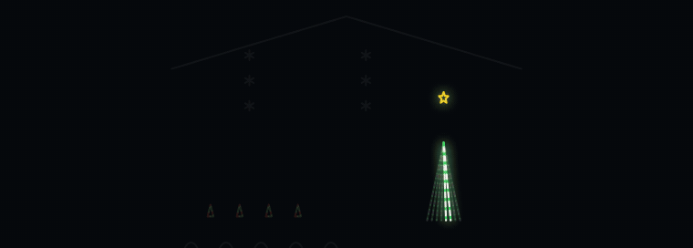

# LOR Sequencer

**Light-O-Rama sequences, without the hundred hours.** Give LOR Sequencer your display and a song, and it builds a native Light-O-Rama sequence (S4, S5 or S6) that knows your arches from your snowflakes, follows the beat and the song's big moments, and checks it against its built-in rules and your own requirements before it is written.

## Start here

1. [Install it](Installing) on Windows, Mac or Linux.
2. [Make your first show](Your-First-Show).
3. Check your wiring with the [10-second display test](Display-Test).

## Learn more

| Page | What it covers |
| --- | --- |
| [Styles](Styles) | Classic, High energy, Elegant, and learning your own style |
| [Requirements](Requirements) | Telling the show what it must do on your display |
| [RGB Props](RGB-Props) | RGB floods and other color props |
| [Singing Faces](Singing-Faces) | Making faces sing along |
| [A New Prop This Year](Adding-New-Props) | Adding props to shows you already have |
| [S4 Users](S4-Users) | Using it with S4 (no previews) |
| [The Workspace](The-Workspace) | Watching, checking and fixing a show in the app |
| [Troubleshooting](Troubleshooting) | Common problems and fixes |
| [FAQ](FAQ) | Short answers |
| [Privacy and Safety](Privacy-and-Safety) | What stays on your computer |
| [For Developers](For-Developers) | Building, testing, contributing |

The full reference is the [user guide](https://github.com/MikeAllen1/light-o-rama-sequence-builder/blob/master/docs/USER_GUIDE.md) in the repository.

---

Free to use, not to sell ([license](https://github.com/MikeAllen1/light-o-rama-sequence-builder/blob/master/LICENSE)). Not affiliated with or endorsed by Light-O-Rama, Inc.
